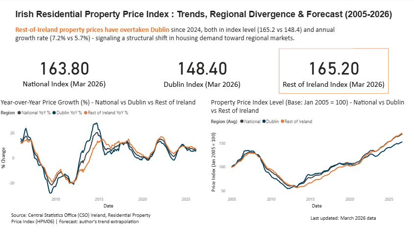
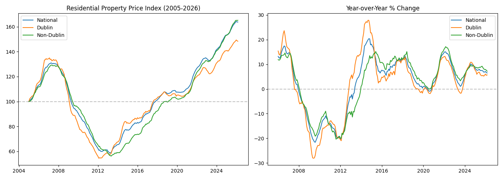
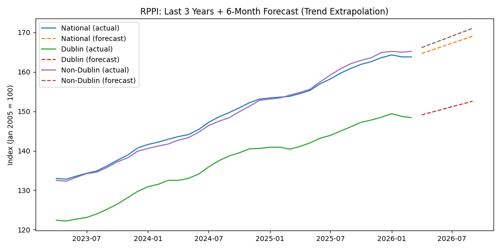

# Irish Residential Property Price Dashboard

**Business question:** How have Irish residential property price indices changed nationally, in Dublin and outside Dublin, and what should a prospective mover investigate?



## Executive summary
An exploratory study of CSO residential property price indices, with regional comparisons, year-on-year changes, and a transparent six-month **scenario extrapolation**. It is not a valuation model, an individual-home price forecast or causal evidence.

The published analysis previously observed faster index growth outside Dublin through March 2026. This is a historical observation, not a prediction that the trend must continue. Remote work and affordability are hypotheses, **not established causal drivers** in this dataset.

## Data
Source: [Central Statistics Office Ireland, HPM06](https://data.gov.ie/dataset/hpm06-residential-property-price-index). Snapshot: `data/irppi_raw.csv`. **Index levels measure relative changes, not comparable euro prices of homes across regions.**

## Reproduce
Requires Python 3.10+. Run from repository root:

```bash
python -m pip install -r requirements.txt
python scripts/irppi_clean_data.py
python scripts/irppi_eda_analysis.py
python scripts/irppi_forecast_analysis.py
python scripts/irppi_backtest.py
python -m pytest -q
```

Outputs: `data/irppi_national_dublin.csv`, `data/rppi_forecast.csv`, and figures in `images/`. Open `dashboard/irppi.pbix` in Power BI Desktop (refresh the report's local file paths where necessary).

## Method
- Select index-level series, parse monthly dates, pivot, calculate MoM and YoY percentage changes.
- Compare national, Dublin and non-Dublin index trends.
- Extrapolate trailing 12-month compound growth six months ahead. This is a **simple unvalidated baseline/scenario**, not a tested forecast.
- Present findings and assumptions in Power BI.




## Project files
- `scripts/irppi_clean_data.py` — cleaning and calculated growth
- `scripts/irppi_eda_analysis.py` — descriptive analysis
- `scripts/irppi_forecast_analysis.py` — extrapolation
- `scripts/irppi_backtest.py` — rolling-origin six-month comparison against last-value and seasonal-naïve baselines; writes `data/irppi_backtest_results.csv`
- `dashboard/irppi.pbix` — dashboard
- `data/` — raw snapshot and prepared files

## Limitations and roadmap
1. A rolling-origin baseline comparison and MAE/RMSE reporting script has been added. **Results have not been independently run/verified in this review**; do not claim accuracy or superiority without reviewing outputs and assumptions.
2. Add schema/duplicate/missing-date tests and data-freshness checks.
3. Verify consistent index-base definitions and interpretation across series.
4. Improve Power BI portability.
5. Test any proposed drivers against independent explanatory data; do not infer causality from divergent index trends.

Tools: Python (pandas, matplotlib), Power BI. AI-assisted implementation, with analytical responsibility retained by the author.

Author: Hitesh Srinivas · [LinkedIn](https://www.linkedin.com/in/hitesh-s-116380252/)
